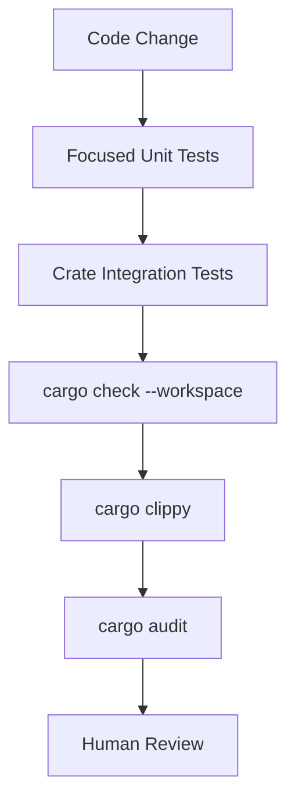

# Contributing to A.D.T.P

Thank you for helping build A.D.T.P This repository is phase-driven, so contributions should preserve the protocol boundary and keep the implementation auditable.

## Development Principles

1. **Phase discipline:** implement only the active phase unless a future-phase scaffold is explicitly needed for compilation.
2. **Protocol first:** shared wire behavior belongs in `adtp-core`.
3. **Backend clarity:** daemon logic belongs in `adtp-client` and `adtp-server`; UI/CLI behavior belongs in later phases.
4. **Security by default:** received files must be decrypted, hash-verified, and audit-logged.
5. **Small, reviewable patches:** avoid broad refactors mixed with feature work.

## Local Setup

```bash
rustup update stable
cargo --version
rustc --version
cargo install cargo-audit
```

Clone and validate:

```bash
cargo fmt --all
cargo check --workspace
cargo test --workspace
cargo clippy --workspace -- -D warnings
cargo audit
```

## Branch and Commit Style

Use descriptive branch names:

```text
feature/phase1-client-daemon
fix/audit-chain-verification
docs/protocol-spec
```

Commit messages should describe the behavior change:

```text
Add server intake validation
Fix audit chain timestamp mismatch
Document Phase 1 daemon flow
```

## Pull Request Checklist

Before opening a PR:

- [ ] Code is formatted with `cargo fmt --all`.
- [ ] `cargo check --workspace` passes.
- [ ] Relevant tests pass.
- [ ] `cargo clippy --workspace -- -D warnings` passes.
- [ ] `cargo audit` has no unreviewed vulnerability findings.
- [ ] Documentation is updated when behavior changes.
- [ ] Security-sensitive changes explain threat model impact.

## Testing Strategy



Recommended test order:

```bash
cargo test --package adtp-core
cargo test --package adtp-client
cargo test --package adtp-server
cargo check --workspace
cargo clippy --workspace -- -D warnings
```

## Adding Dependencies

Before adding a dependency:

- Prefer workspace-level dependency declarations in `Cargo.toml`.
- Confirm the crate is maintained and reasonably popular.
- Avoid dependencies for trivial utilities.
- Run `cargo audit` after updating `Cargo.lock`.
- Document why the dependency is needed if it affects security, networking, or storage.

## Code Organization

| Type of code | Location |
| --- | --- |
| Shared constants/types/errors | `crates/adtp-core/src/types.rs`, `errors.rs` |
| Packet wire behavior | `crates/adtp-core/src/protocol.rs` |
| Cryptography and hashing | `crates/adtp-core/src/encryption.rs`, `integrity.rs` |
| QUIC transport | `crates/adtp-core/src/transfer.rs` |
| Client daemon behavior | `crates/adtp-client/src` |
| Server daemon behavior | `crates/adtp-server/src` |
| User CLI | `crates/adtp-cli` in Phase 5 |

## Review Expectations

Reviewers should verify:

- Wire compatibility is preserved or explicitly versioned.
- Audit chain computation remains deterministic.
- File writes are guarded by integrity checks.
- Error handling uses `AdtpError` where appropriate.
- Future-phase work is clearly marked as planned rather than implied as complete.
