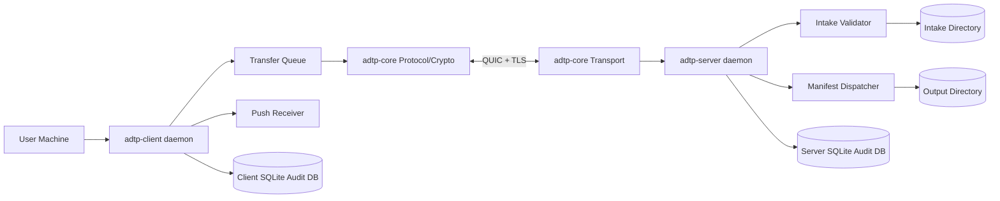
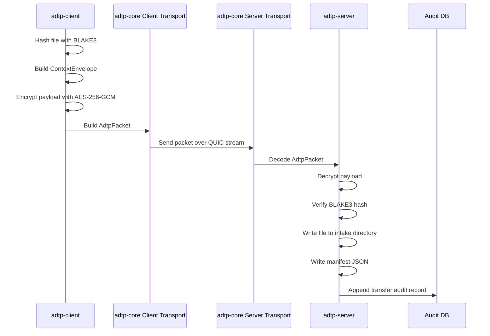

# ADTP — Agent Direct Transfer Protocol

ADTP is a backend-first file transfer protocol for moving files directly between a user machine and an AI agent server. The project currently implements the Phase 0 foundation layer and the Phase 1 transfer engine/daemon layer in Rust.

## Current Status

| Phase | Area | Status | Main Crates |
| --- | --- | --- | --- |
| 0 | Foundation protocol | Implemented | `adtp-core` |
| 1 | Transfer engine and daemons | Implemented | `adtp-client`, `adtp-server` |
| 2 | Intelligence/context extraction | Planned | `adtp-mcp`, extractors |
| 3 | MCP server bridge | Planned | `packages/adtp-mcp` |
| 4 | REST API | Planned | `adtp-api` |
| 5 | CLI | Scaffolded only | `adtp-cli` |
| 6 | Desktop app | Scaffolded only | `desktop` |
| 7 | Hardening and launch | Planned | all crates |

## What Is Implemented

- QUIC transport over `quinn` in `adtp-core`.
- ADTP packet serialization/deserialization.
- BLAKE3 hashing for integrity checks.
- AES-256-GCM encryption/decryption for file payloads.
- Ephemeral session key material scaffolding.
- Client daemon modules for config, queueing, receiving pushed files, folder watching, and auditing.
- Server daemon modules for config, intake validation, manifest dispatch, push support, and auditing.
- SQLite audit logs with tamper-evident hash chains.
- Integration tests for QUIC send/receive, server intake/dispatch, and audit verification.

## Architecture



## Packet Flow



## Repository Layout

| Path | Purpose |
| --- | --- |
| `crates/adtp-core` | Shared protocol types, errors, packet format, crypto, sessions, QUIC transport. |
| `crates/adtp-client` | User-machine daemon: config, queue, receiver, watcher, audit, daemon loop. |
| `crates/adtp-server` | AI-server daemon: config, intake, dispatcher, push, audit, accept loop. |
| `crates/adtp-cli` | Future CLI package scaffold. |
| `crates/adtp-proto` | Future protobuf package scaffold. |
| `docs/spec` | Protocol and security specifications. |
| `docs/guides` | Operator and developer guides. |
| `docs/deployment` | Deployment environment notes. |
| `examples` | Planned scenario walkthroughs. |

## Requirements

- Rust stable toolchain with Cargo.
- Linux/macOS/Windows supported by Rust dependencies, though current daemon validation has been performed locally on Linux.
- Network permission for QUIC integration tests because they bind local UDP sockets.
- Optional: `cargo-audit` for RustSec advisory checks.

## Build and Test

```bash
cargo fmt --all
cargo test --package adtp-core
cargo test --package adtp-client
cargo test --package adtp-server
cargo check --workspace
cargo clippy --workspace -- -D warnings
cargo audit
```

If a local sandbox blocks socket binding, run the QUIC tests in a normal shell.

## Running Daemons

Server:

```bash
cargo run --package adtp-server
```

Client:

```bash
cargo run --package adtp-client
```

The client currently requires a default agent in `~/.config/adtp/client.toml`. Phase 5 will add CLI commands to manage this file.

Example client config:

```toml
receive_dir = "/home/alice/adtp-received"
keys_dir = "/home/alice/.config/adtp/keys"
audit_db = "/home/alice/.config/adtp/client-audit.db"
max_file_size = 10737418240
connect_timeout_secs = 30

[[agents]]
name = "local"
host = "127.0.0.1"
port = 40001
default = true
```

## Engineering Rules

- Build phase-by-phase; do not implement future phases inside current-phase crates without a clear boundary.
- Keep protocol logic in `adtp-core` and daemon orchestration in client/server crates.
- Never bypass BLAKE3 verification before writing received files.
- Never treat Phase 1 zero-key test mode as production cryptography; Phase 2/3 must replace it with real handshake-derived keys.
- Preserve audit-log chain semantics when changing audit code.

## Security Note

Phase 1 is a development-grade transfer engine. Payload encryption and integrity checks work, but the daemon still uses development self-signed TLS and zero session keys in daemon flow until the handshake layer is completed. See `docs/spec/security-model.md` for details.
