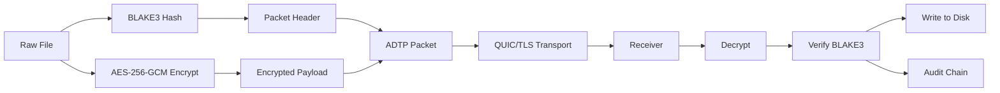

# Security Policy

Security review is mandatory for networking, cryptography, file-system writes, audit logs, and configuration changes.

## Supported Versions

| Version | Status |
| --- | --- |
| `0.1.x` | Active development, security fixes accepted |

## Reporting a Vulnerability

Please do not open a public issue for exploitable vulnerabilities. Report privately to the maintainers with:

- Affected crate/module.
- Reproduction steps.
- Impact description.
- Suggested mitigation if known.
- Whether the issue requires coordinated disclosure.
- You can reach the [maintainer](https://github.com/Contractor-x)

## Current Security Model



## Security Requirements for Changes

- Do not write received files before integrity verification passes.
- Do not remove audit logging for transfer/session events.
- Do not introduce plaintext payload transfer paths.
- Do not log raw file contents, private keys, or derived session keys.
- Validate file sizes before processing large payloads.
- Treat config paths as untrusted input.

## Dependency Auditing

Run:

```bash
cargo audit
```

## Threat Model Summary

| Threat | Current Mitigation |
| --- | --- |
| Payload tampering | AES-GCM authentication and BLAKE3 content hash verification |
| Packet corruption | Header validation and deserialization checks |
| Audit tampering | Linked BLAKE3 audit chain |
| Oversized files | File-size guards in protocol/intake layers |
| Network interception | QUIC/TLS transport; production cert validation still planned |
| Replay/identity attacks | Full session handshake/signatures planned for later phase |
