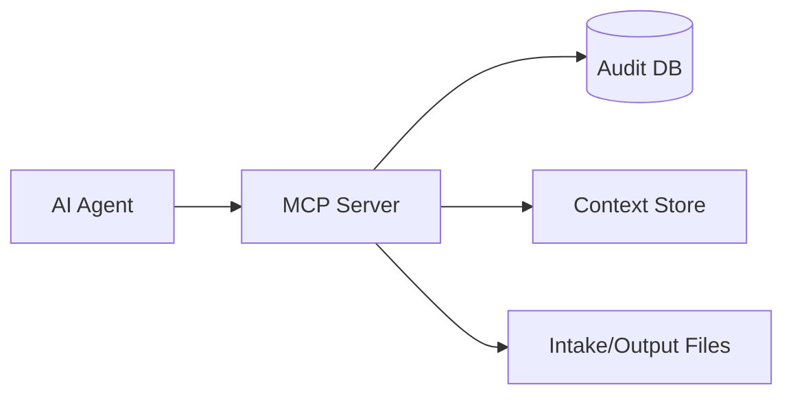

# MCP Resources Reference

MCP resources are planned for Phase 3.

## Planned Resources

| Resource | Purpose |
| --- | --- |
| `adtp://transfers/recent` | Recent transfer records. |
| `adtp://audit/status` | Audit chain verification state. |
| `adtp://files/{transfer_id}/metadata` | File metadata and context. |
| `adtp://sessions/current` | Active session details. |

## Resource Flow

