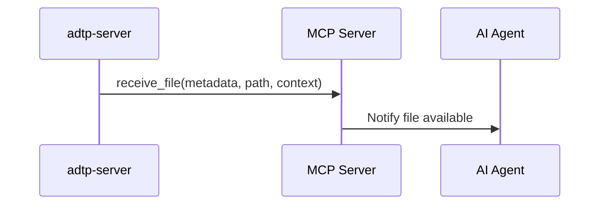

# MCP Tools Reference

MCP tools are planned for Phase 3 and are not implemented yet.

## Planned Tool: `receive_file`

Accepts a file delivered by ADTP and exposes it to the agent.

## Planned Tool: `send_file`

Allows the agent to push a generated file back to the user machine through `adtp-server`.

## Planned Tool: `verify_audit_chain`

Returns whether the local audit log chain verifies.

## Planned Tool: `list_transfers`

Returns recent transfer records from the audit database.
