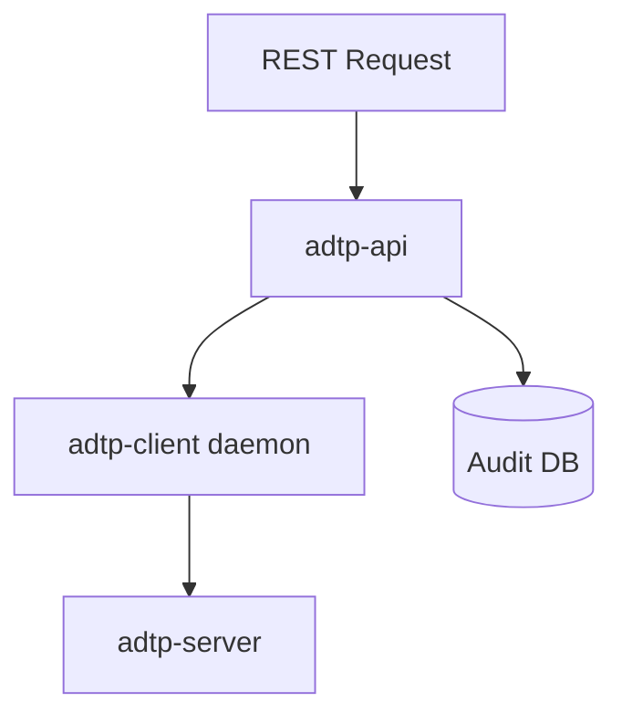

# REST API Reference

The REST API is planned for Phase 4 and is not implemented yet.

## Planned Endpoints

| Method | Path | Purpose |
| --- | --- | --- |
| `GET` | `/health` | Service health. |
| `GET` | `/transfers` | List transfers. |
| `GET` | `/transfers/{id}` | Get one transfer. |
| `POST` | `/send` | Enqueue a send request. |
| `POST` | `/watch` | Register a folder watch. |
| `DELETE` | `/watch/{id}` | Remove a folder watch. |
| `GET` | `/audit/verify` | Verify audit chain. |

## Planned API Flow

## Implementation Note

The REST API must be a thin adapter over daemon capabilities, not a second transfer engine.
