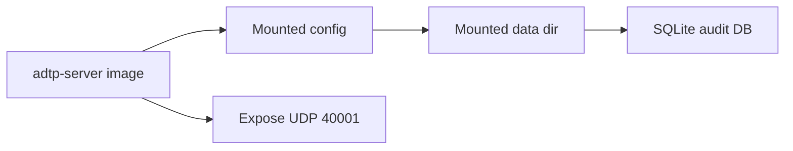

# Docker Deployment

Docker packaging is planned. Current development uses Cargo directly.

## Planned Container Shape



## Future Docker Run Example

```bash
docker run --rm \
  -p 40001:40001/udp \
  -v adtp-data:/var/lib/adtp \
  -v ./server.toml:/etc/adtp/server.toml:ro \
  adtp-server:latest
```

## Validation Commands

```bash
cargo fmt --all
cargo check --workspace
cargo test --workspace
cargo clippy --workspace -- -D warnings
cargo audit
```

## Runtime Ports

| Service | Protocol | Default |
| --- | --- | --- |
| `adtp-server` | QUIC/UDP | `40001` |

## Files and Directories

| Item | Default |
| --- | --- |
| Client config | `~/.config/adtp/client.toml` |
| Server config | OS config dir + `adtp/server.toml` |
| Client receive dir | `~/adtp-received` |
| Server intake dir | OS data dir + `adtp/intake` |
| Server output dir | OS data dir + `adtp/output` |
