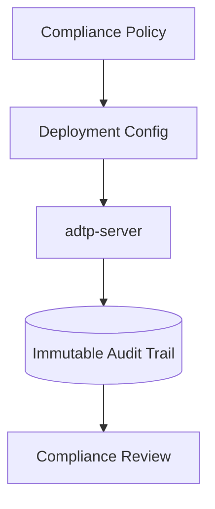

# Government Deployment

Government deployment requires additional compliance review before production use.

## Controls to Review

- Audit retention policy.
- Data residency.
- TLS certificate management.
- Key lifecycle and rotation.
- Access control for agent servers.
- Incident response and evidence preservation.



## Validation Commands

```bash
cargo fmt --all
cargo check --workspace
cargo test --workspace
cargo clippy --workspace -- -D warnings
cargo audit
```

## Runtime Ports

| Service | Protocol | Default |
| --- | --- | --- |
| `adtp-server` | QUIC/UDP | `40001` |

## Files and Directories

| Item | Default |
| --- | --- |
| Client config | `~/.config/adtp/client.toml` |
| Server config | OS config dir + `adtp/server.toml` |
| Client receive dir | `~/adtp-received` |
| Server intake dir | OS data dir + `adtp/intake` |
| Server output dir | OS data dir + `adtp/output` |
