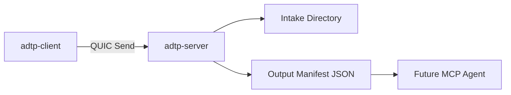

# Agent Setup Guide

Phase 1 prepares the server-side daemon that will later sit beside an AI agent. The actual MCP bridge is planned for Phase 3.

## Current Server Responsibilities

- Listen for QUIC connections.
- Receive `Send` packets.
- Decrypt file payloads.
- Verify BLAKE3 file hashes.
- Write files to `intake_dir`.
- Write manifest JSON files to `output_dir`.
- Record sessions and transfers in SQLite audit logs.

## Directory Flow



## Example Server Config

```toml
bind_addr = "0.0.0.0"
port = 40001
intake_dir = "/var/lib/adtp/intake"
output_dir = "/var/lib/adtp/output"
tls_cert = ""
tls_key = ""
audit_db = "/var/lib/adtp/server-audit.db"
max_connections = 100
max_file_size = 10737418240
```

## Manifest Shape

The dispatcher writes:

```json
{
  "event": "file_received",
  "file_path": "/path/to/intake/file.txt",
  "filename": "file.txt",
  "mime_type": "text/plain",
  "file_size": 123,
  "context": {}
}
```

## Future MCP Integration

Phase 3 will replace manifest polling with direct MCP tool calls.
