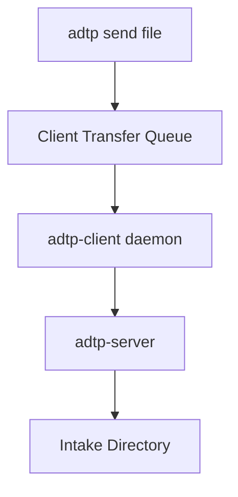

# CLI Usage Guide

`adtp-cli` is scaffolded but not implemented yet. Phase 5 will add user-facing commands.

## Planned Commands

```bash
adtp connect --name local --host 127.0.0.1 --port 40001
adtp send ./report.pdf --agent local
adtp receive --dir ~/adtp-received
adtp watch ~/Documents --agent local
adtp status
adtp history
adtp audit verify
```

## Planned CLI Flow



## Current Workaround

Use integration tests or daemon internals for transfer validation until Phase 5 implements CLI commands.
