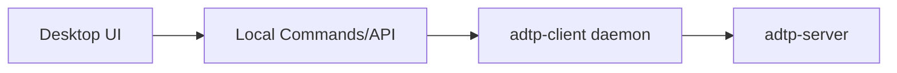

# Desktop App Guide

The desktop app is planned for Phase 6. No production desktop UI is implemented yet.

## Planned Responsibilities

- Show connection status.
- Manage known agents.
- Let users drag/drop files for transfer.
- Show transfer history from audit DB.
- Manage folder watches.
- Display received file notifications.

## Planned Flow

## Current Backend Hooks

Phase 1 already provides:

- `ClientConfig` for settings.
- `TransferQueue` for outgoing files.
- `FolderWatcher` for watch registration.
- `AuditLog` for history and verification.
- `FileReceiver` for pushed files.
