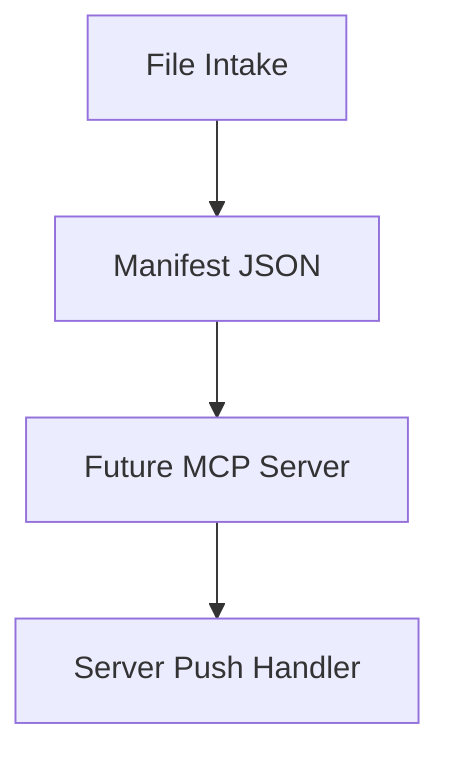

# MCP Integration Guide

MCP integration is planned for Phase 3. Phase 1 prepares a manifest-based bridge point.

## Current Placeholder

Server dispatcher writes manifest JSON files to `output_dir`.

## Planned MCP Tools

- `receive_file`
- `send_file`
- `list_transfers`
- `verify_audit_chain`
- `get_context`

## Planned Resources

- Transfer history.
- File metadata.
- Context summaries.
- Audit verification status.

## Security Expectations

The MCP bridge must not bypass:

- Payload encryption.
- BLAKE3 verification.
- Audit logging.
- File-size limits.
