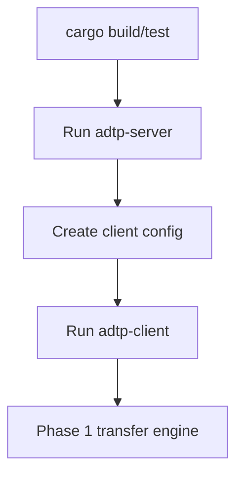

# Quickstart

This guide builds and tests the implemented Phase 0/1 backend.

## 1. Install Rust

```bash
rustup update stable
source "$HOME/.cargo/env"
rustc --version
cargo --version
```

## 2. Install Audit Tooling

```bash
cargo install cargo-audit
```

## 3. Validate Workspace

```bash
cargo fmt --all
cargo test --package adtp-core
cargo test --package adtp-client
cargo test --package adtp-server
cargo check --workspace
cargo clippy --workspace -- -D warnings
cargo audit
```

## 4. Run Server

```bash
cargo run --package adtp-server
```

Default server config is written to your OS config directory at `adtp/server.toml`.

## 5. Configure Client

Create or edit `~/.config/adtp/client.toml`:

```toml
receive_dir = "/home/alice/adtp-received"
keys_dir = "/home/alice/.config/adtp/keys"
audit_db = "/home/alice/.config/adtp/client-audit.db"
max_file_size = 10737418240
connect_timeout_secs = 30

[[agents]]
name = "local"
host = "127.0.0.1"
port = 40001
default = true
```

## 6. Run Client

```bash
cargo run --package adtp-client
```

## System Flow



## Notes

- Phase 5 will add CLI commands for sending files manually.
- Phase 2/3 will add intelligence and MCP integration.
- QUIC tests need permission to bind local UDP sockets.
