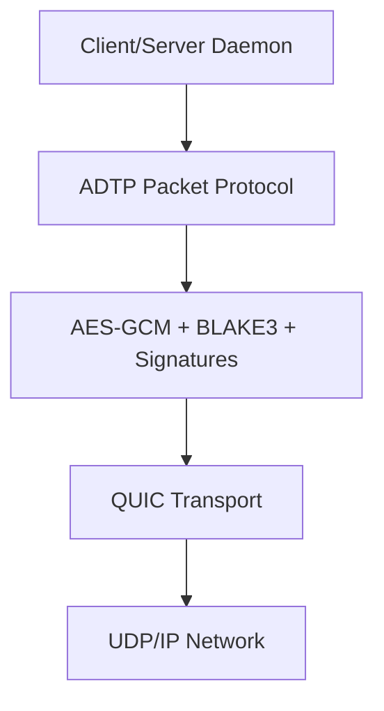
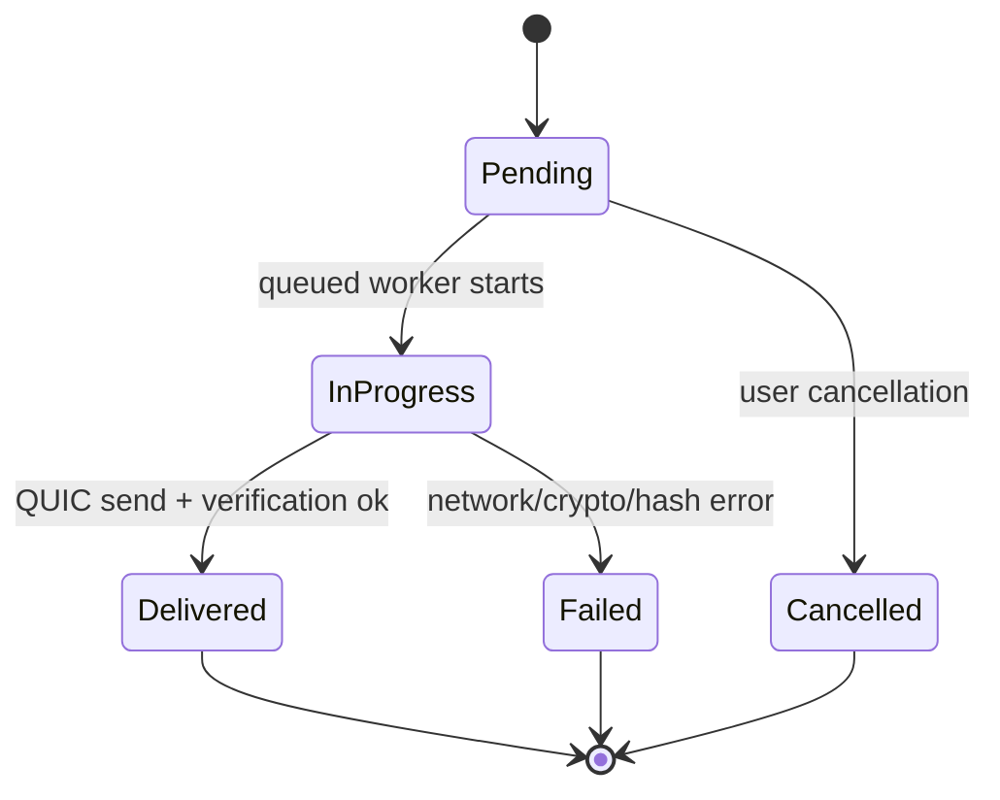

# ADTP Protocol Specification

ADTP v0.1.0 defines a QUIC-based file transfer protocol for direct communication between a user machine and an AI agent server.

## Goals

- Transfer encrypted files over QUIC.
- Carry structured file metadata and context alongside each payload.
- Verify file integrity with BLAKE3 before disk writes.
- Keep a tamper-evident audit trail.
- Preserve future compatibility through explicit packet versioning.

## Layers

## Phase 0 Core Components

| Module | Responsibility |
| --- | --- |
| `types.rs` | Protocol constants, transfer enums, file metadata, sessions, audit records. |
| `errors.rs` | Typed error enum used across crates. |
| `protocol.rs` | Packet header/body/signature structure and serialization. |
| `integrity.rs` | BLAKE3 hashing, ed25519 signing helpers, audit-chain hashing. |
| `encryption.rs` | AES-256-GCM encryption/decryption and HKDF key derivation. |
| `session.rs` | Ephemeral key generation and session record creation. |
| `transfer.rs` | QUIC client/server and framed stream send/receive. |

## Phase 1 Daemon Components

| Crate | Responsibility |
| --- | --- |
| `adtp-client` | Sends files, receives pushes, watches folders, writes client audit log. |
| `adtp-server` | Accepts clients, validates incoming files, writes manifests, writes server audit log. |

## Transfer State Machine

## Compatibility

Packets include:

- Magic bytes: `0xAD7F1A00`.
- Version: `1`.
- Transfer type.
- Session ID.
- Transfer ID.
- Payload/context lengths.
- Nonce.
- Content hash.

Receivers must reject unknown magic bytes, unsupported versions, oversized packets, oversized context blocks, and malformed byte buffers.
