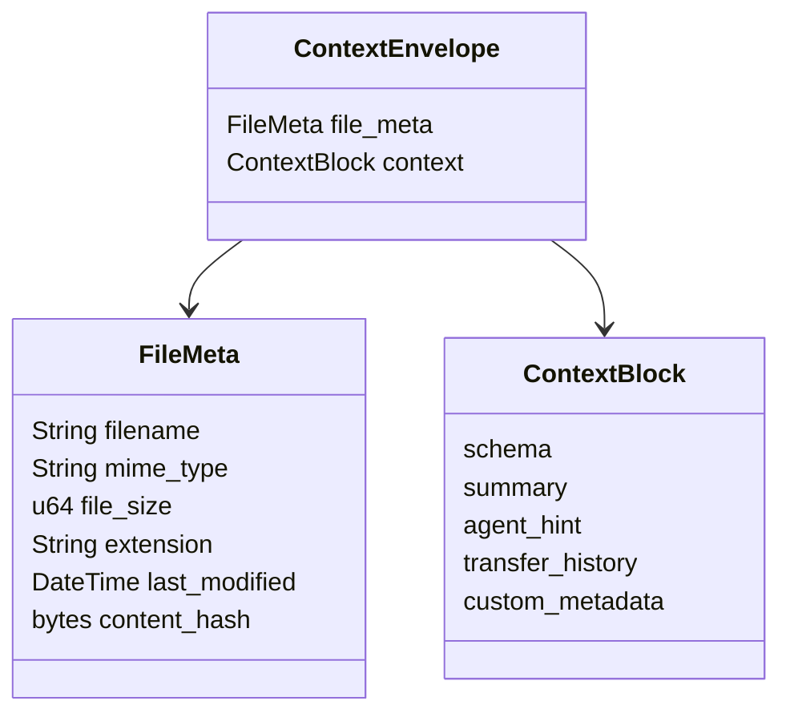

# Context Block Specification

The context block is the metadata sidecar sent with each file transfer. It is plaintext JSON in Phase 0/1 and is represented by `ContextEnvelope`.

## Structure

## `FileMeta`

`FileMeta` is implemented now and required for every file transfer.

| Field | Purpose |
| --- | --- |
| `filename` | Original file name. |
| `mime_type` | MIME type inferred from file bytes. |
| `file_size` | Plaintext file size. |
| `extension` | Lowercase file extension. |
| `last_modified` | Optional source-file timestamp. |
| `content_hash` | BLAKE3 hash of raw plaintext bytes. |

## `ContextBlock`

`ContextBlock` is implemented as a shape but Phase 2 will populate intelligence fields.

| Field | Status | Purpose |
| --- | --- | --- |
| `schema` | Planned | Structured data schema, headings, columns, etc. |
| `summary` | Planned | Human-readable file summary. |
| `agent_hint` | Planned | Suggested action for an AI agent. |
| `transfer_history` | Implemented container | Previous related transfers. |
| `custom_metadata` | Implemented container | Caller-provided key/value metadata. |

## Phase 1 Behavior

Phase 1 uses `ContextBlock::default()` and sends only reliable file metadata. The server dispatcher writes a manifest JSON containing the context envelope so future agent layers can consume it.
