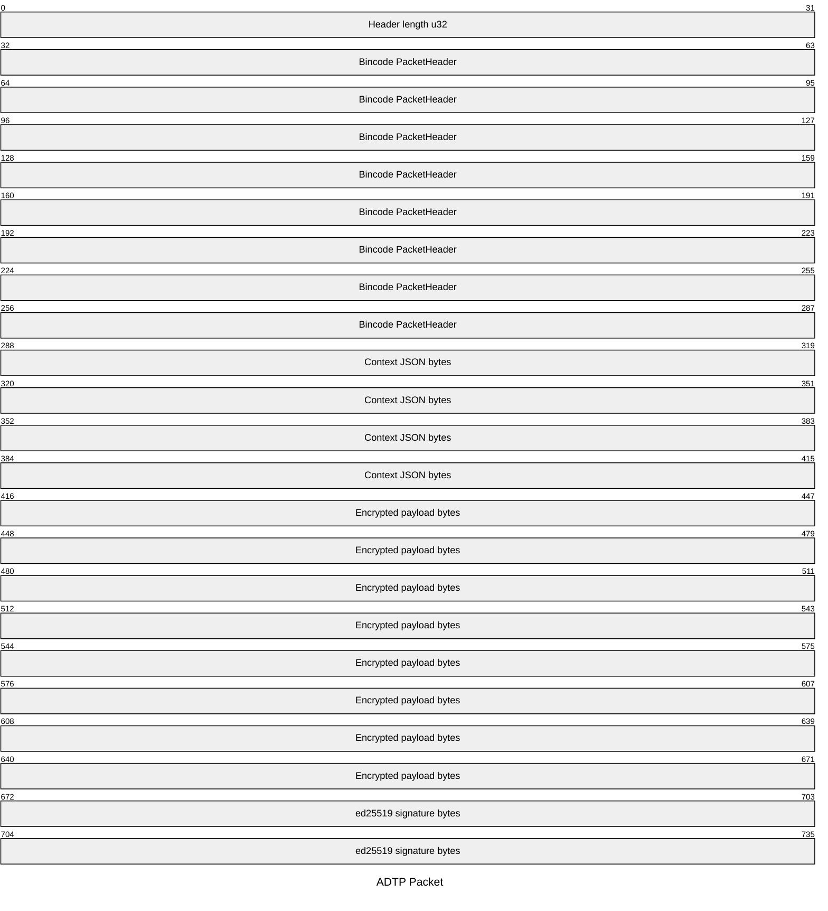
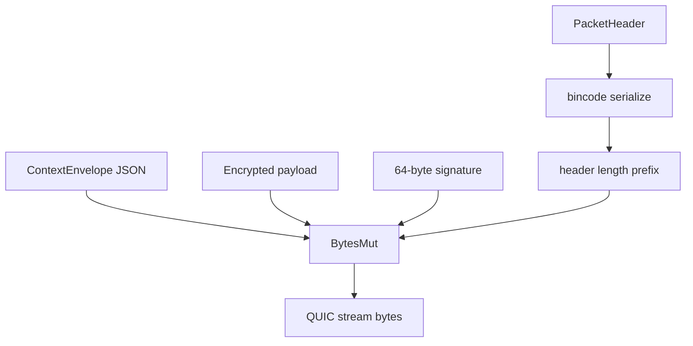

# ADTP Packet Structure

The ADTP packet is defined in `crates/adtp-core/src/protocol.rs`.

## Logical Layout



Mermaid packet sizes above are illustrative. Real context and payload lengths are variable and recorded in the header.

## Header Fields

| Field | Type | Purpose |
| --- | --- | --- |
| `magic` | `u32` | Identifies ADTP packets. |
| `version` | `u8` | Protocol version. |
| `transfer_type` | `TransferType` | Receiver action. |
| `priority` | `Priority` | Queue priority. |
| `flags` | `u8` | Reserved. |
| `session_id` | `Uuid` | Connection/session identity. |
| `transfer_id` | `Uuid` | File transfer identity. |
| `timestamp_ns` | `u64` | Packet creation timestamp. |
| `context_len` | `u32` | Context byte length. |
| `payload_len` | `u64` | Encrypted payload byte length. |
| `nonce` | `[u8; 12]` | AES-GCM nonce. |
| `content_hash` | `[u8; 32]` | BLAKE3 hash of plaintext file bytes. |

## Serialization Flow



## Deserialization Rules

1. Read a four-byte header length prefix.
2. Deserialize `PacketHeader` with `bincode`.
3. Validate magic, version, payload size, and context size.
4. Read `context_len` bytes.
5. Read `payload_len` bytes.
6. Read exactly 64 signature bytes.
7. Reject malformed or truncated buffers.

## Signable Bytes

`signable_bytes()` returns:

```text
bincode(header) || blake3(context) || blake3(payload)
```

Phase 1 carries zero signatures in daemon flow until production handshake/signing is completed.
