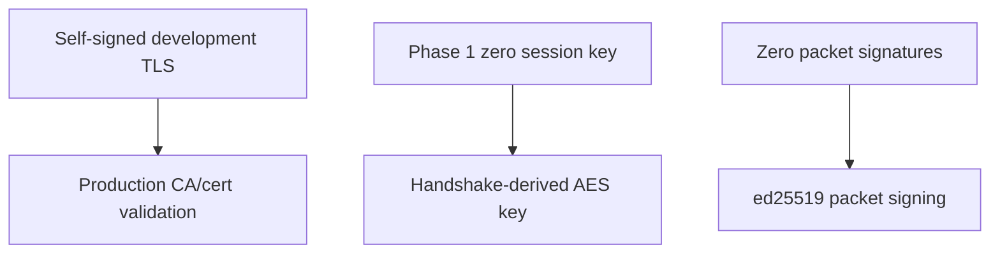
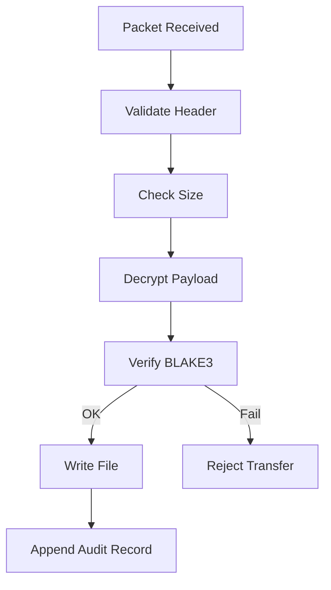

# ADTP Security Model

This document describes the security design currently implemented and the hardening still required before production use.

## Implemented Controls

| Control | Implementation |
| --- | --- |
| Transport encryption | QUIC/TLS through `quinn` and `rustls`. |
| Payload encryption | AES-256-GCM in `adtp-core::encryption`. |
| File integrity | BLAKE3 hash in packet header and `FileMeta`. |
| Tamper-evident audit | SQLite audit records chained with BLAKE3. |
| Packet validation | Magic/version/size/context validation. |

## Development Limitations



Phase 1 proves daemon transfer mechanics. It is not the final production security posture.

## Receive-Side Safety Rules

1. Parse packet header and context.
2. Reject oversized files.
3. Decrypt payload.
4. Verify BLAKE3 hash.
5. Only then write bytes to disk.
6. Append audit record.



## Audit Chain

Each transfer record computes:

```text
chain_hash = BLAKE3(previous_chain_hash || entry_data)
```

The chain starts from `ADTP_GENESIS_ASHIR_TECH_2026`.

## Production Hardening Checklist

- Replace zero session keys with ECDH-derived keys in daemon flow.
- Enforce ed25519 signature verification.
- Replace insecure/self-signed client verifier for production deployments.
- Add replay protection.
- Add explicit authorization for client identities.
- Add secure key storage and rotation.
- Add structured security tests for malformed packets and tampered audit rows.
