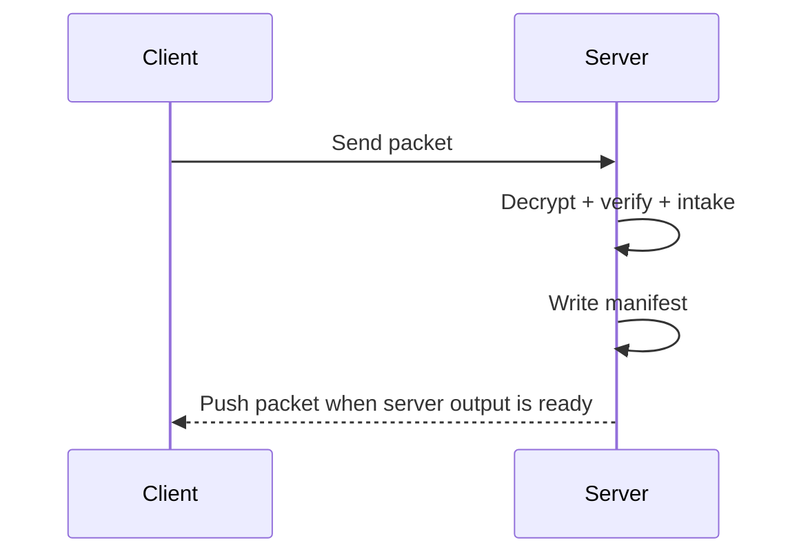

# Transfer Types

ADTP packet behavior is selected by `TransferType` in `adtp-core::types`.

| Type | Byte | Status | Meaning |
| --- | ---: | --- | --- |
| `Send` | `0x01` | Implemented | Client sends file to server. |
| `Push` | `0x02` | Implemented helper | Server pushes file to client. |
| `Ack` | `0x03` | Planned | Receiver confirms delivery. |
| `Error` | `0x04` | Planned | Receiver reports failure reason. |
| `Watch` | `0x05` | Planned protocol command | Register folder watch. |
| `Unwatch` | `0x06` | Planned protocol command | Remove folder watch. |
| `Status` | `0x07` | Planned | Query queue/status. |
| `History` | `0x08` | Planned | Query audit history. |
| `Handshake` | `0x09` | Planned | Exchange public keys. |
| `Ping` | `0x0A` | Partial | Keepalive ping. |
| `Pong` | `0x0B` | Planned | Keepalive response. |

## Current Flow

## Priority

Priority values are queue hints:

- `Low`
- `Normal`
- `Urgent`
- `Critical`

Phase 1 stores priority in queue items but does not yet implement priority scheduling.
