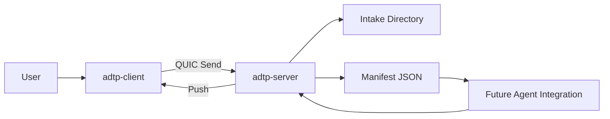

# Local LLM Ollama Example

This example is a planned scenario guide. The backend transfer layer exists, while CLI/UI/agent automation arrives in later phases.

## Scenario

A workstation sends files to a local or LAN-hosted Ollama agent environment.

## Flow

## Current Manual Validation

Use Phase 1 integration tests to validate the transfer engine. Full scenario automation is planned for future phases.
