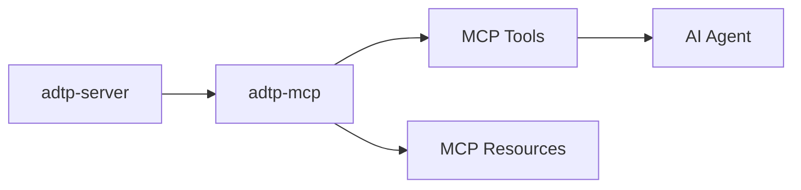

# ADTP MCP Package

This package is reserved for the Phase 3 MCP server.

## Planned Role

## Planned Files

- `server.py` or Rust/Python MCP server entrypoint.
- Tool definitions for receiving and sending files.
- Resource definitions for audit and transfer history.
- Context adapters from Phase 2.

## Boundary

The MCP package should not reimplement encryption, transport, or audit-chain logic. It should call the daemon/server APIs and consume manifest/context outputs.
