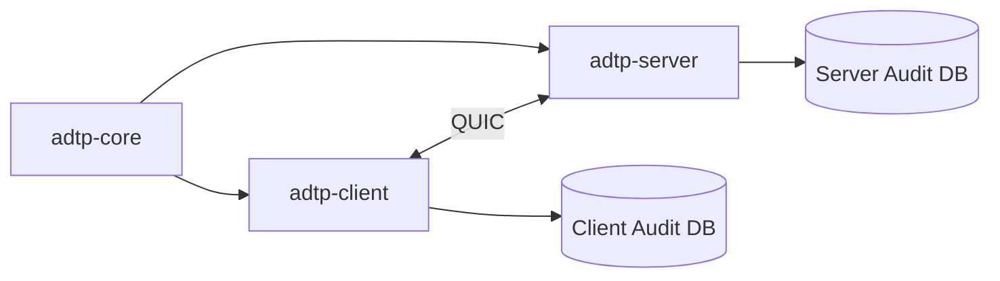

# Project Details

This file records local project setup notes and current implementation state.

## Completed Work

- Phase 0: `adtp-core` foundation implemented and tested.
- Phase 1: `adtp-client` and `adtp-server` daemon layer implemented and tested.
- Documentation placeholders expanded with architecture, diagrams, and workflow details.

## Local Tooling Notes

Rust installation:

```bash
curl --proto '=https' --tlsv1.2 -sSf https://sh.rustup.rs | sh -s -- -y
source "$HOME/.cargo/env"
rustc --version
```

Cargo audit:

```bash
cargo install cargo-audit
cargo audit
```

## Validation Baseline

```bash
cargo fmt --all
cargo test --package adtp-core
cargo test --package adtp-client
cargo test --package adtp-server
cargo check --workspace
cargo clippy --workspace -- -D warnings
cargo audit
```

## Current Architecture


## Phase 2
- Phse 2 was a success this phase focuses moslty on python files and engine 
- added some files and protocol.
- less code than i expected tho.
- but more protocols for transfer and status reports. 
Well unto the next.